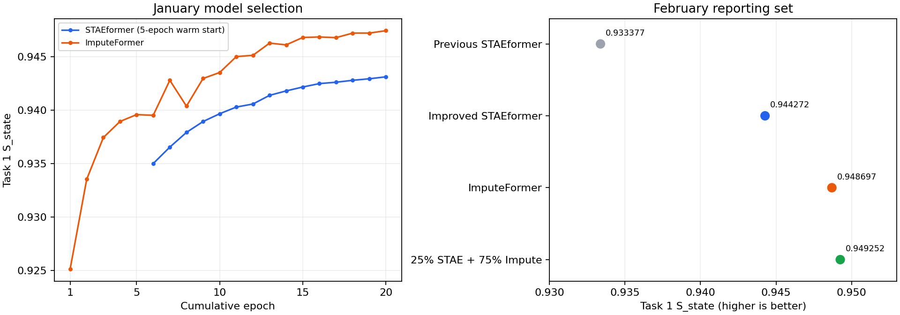

# Task 1 추가 실험: 004–006

## 비교 목적

003의 Kaggle Public 점수는 **0.76826**이다. Task 2의 CatBoost 예측과 Task 4의 NNLS 예측을 그대로 두고, Task 1의 speed·flow만 바꿔 세 번 제출한다. Task 3도 같은 speed·flow를 사용하므로 리더보드 변화에는 Task 1과 Task 3이 함께 반영된다.

| 제출 | Task 1 모델 | 달라진 점 |
|---|---|---|
| 004 | 보간 + STAEformer residual | 48시점 창, 관측 품질·앞뒤 관측까지의 거리, 추가 학습 |
| 005 | 보간 + ImputeFormer residual | 저랭크 시공간 attention, Fourier 정규화 |
| 006 | 004와 005의 가중 평균 | 1월에서 전체 패널에 공통으로 쓸 비율 하나 선택 |

**물리 GPU 9만 사용한다.** 코드 내부의 `cuda:0`은 `CUDA_VISIBLE_DEVICES=9`로 선택한 물리 GPU 9다. 두 모델은 같은 GPU에서 학습한다.

## 전처리와 입력

원본 릴리스를 날짜·링크 순서로 정렬한 검증된 캐시 `cache/preprocessed_v1`을 사용한다. 10개 방향 패널, 1,583개 링크에 하나의 모델을 공유한다. flow는 차로 수로 나누어 학습하고 제출할 때 원래 단위로 되돌린다.

기본 입력은 관측 speed, 관측 flow/차로, 관측 여부, 보간 speed, 보간 flow/차로의 5개 채널이다. STAEformer에는 다음 3개를 더한다.

- 현재 셀이 관측됐을 때의 `pct_observed / 100`; 가린 셀은 0.
- 이전 관측까지의 시점 수. 하루 길이로 제한하고 `log1p`로 정규화.
- 다음 관측까지의 시점 수. 동일하게 정규화.

하루 전체에서 **관측 가능한 값만** 보간에 쓴다. Task 1은 이미 주어진 구간의 결측 복원이다. 다음 관측 사용은 이 실험에서 허용하는 오프라인 복원 방식이며, 미래 예측 Task 2에는 적용하지 않는다.

학습에서는 eligible이고 speed·flow가 모두 있는 셀에 20/30/50%의 독립 무작위 mask를 만든다. 가린 셀에서만 복원 오차를 계산한다. 공식 평가 타깃은 `task1/*/train/sample_submission_state.csv`의 좌표만 사용한다.

## 기간 분할과 모델 선택

| 기간 | 용도 |
|---|---|
| 2030-06 ~ 2030-12 | 로컬 모델 학습 |
| 2031-01 | epoch·residual 비율·앙상블 비율 선택 |
| 2031-02 | 선택 완료 후 비교 결과 보고 |
| 2030-06 ~ 2031-02 전체 | 제출 모델 재학습 |
| 2031-03 / 2031-04 | 공식 validation / private 입력으로 제출 예측 생성 |

2월은 이전 실험에서도 평가한 기간이므로 새롭게 확보한 독립 테스트라고 해석하지 않는다. 이번 실험의 선택 기준은 1월에 고정했다. 실제 validation/private 정답은 공개돼 있지 않다.

최대 누적 **20 epoch**, 최소 8 epoch, 검증 점수가 4 epoch 연속으로 `0.00001` 이상 개선되지 않으면 종료한다. residual 비율 후보는 0.5/0.75/1.0이다. 보간 단독 0.0도 기록하지만 모델 비교용 제출 후보에서는 제외한다.

STAEformer는 기존 5 epoch 체크포인트에서 이어 학습한다. 로컬 단계의 시작점은 **6~12월만** 학습한 `staeformer_residual_001/last.pt`이다. 24시점 embedding을 두 번 반복해 48시점으로 확장하고, 새 입력 채널의 초기 가중치는 0으로 둔다. 재학습 단계에서만 전체 9개월을 학습한 `staeformer_final_003/final.pt`를 시작점으로 쓴다. 이 체크포인트를 로컬 선택에 사용하면 코드가 오류를 낸다.

ImputeFormer는 처음부터 학습한다. 이전 구현의 핵심 attention을 유지하되 residual 출력층의 활성화를 GELU로 바꾸고 AdamW, 시작 학습률 0.0003, Fourier 계수 0.01을 사용한다. 원 논문의 결과를 그대로 재현한 모델이 아니라, 이 데이터의 두 채널 residual 복원에 맞춘 변형이다.

두 모델 모두 BF16, seed 42, gradient clipping 1.0을 사용한다. 추론할 때 창을 절반씩 겹쳐 residual을 평균한다. STAEformer는 48시점/stride 24, ImputeFormer는 24시점/stride 12다.

006의 STAEformer 가중치 후보는 0.25/0.5/0.75다. 1월에서 하나를 선택하고, 세 제출 CSV를 모두 확정한 뒤 업로드한다. Kaggle 점수를 보고 세 번째 제출의 비율을 바꾸지 않는다.

## 결과

모델 선택, 전체 기간 재학습, 추론과 **Kaggle 3건 제출을 완료했다.** 두 모델 모두 20 epoch, residual 비율 1.0을 사용했다. STAEformer의 20 epoch는 기존 5 epoch에 개선 설정으로 15 epoch를 더 학습한 누적 횟수다.

### 실제 Kaggle Public 결과

2026-10-21 제출. 세 건 모두 `COMPLETE`이며 추가 제출은 정확히 3회 사용했다.

| 제출 | Task 1 모델 | Public | 003 대비 | 제출 번호 |
|---|---|---:|---:|---|
| 003 | 기존 STAEformer 5 epoch | 0.76826 | — | 57461328 |
| 004 | 개선 STAEformer | 0.77803 | +0.00977 | 57468104 |
| 005 | ImputeFormer | 0.78138 | +0.01312 | 57468122 |
| 006 | STAEformer 25% + ImputeFormer 75% | **0.78255** | **+0.01429** | 57468140 |

세 후보 모두 기존 점수를 넘었고, **006 앙상블이 가장 높았다.** Task 2·4의 244,708행은 003과 정확히 동일하다. 따라서 이번 총점 변화는 같은 speed·flow로 평가하는 Task 1·3의 합산 효과다. 각각의 실제 점수는 공개된 총점만으로 분리할 수 없다.

각 CSV는 공식 템플릿과 같은 **6,980,503행**이다. state 6,735,795행, queue 174,000행, odme 70,708행의 누락·중복·비정상 수치 및 CSV 저장 전후 일치 검사를 통과했다. 세 CSV의 해시는 첫 업로드 전에 확정했다. 학습은 물리 GPU 9에서 완료했고 학습 프로세스도 종료했다.

- [004 Kaggle 결과](../submissions/004_staeformer/result.json)
- [005 Kaggle 결과](../submissions/005_imputeformer/result.json)
- [006 Kaggle 결과](../submissions/006_ensemble/result.json)
- [로컬·Kaggle 비교 데이터](../runs/ensemble_006/comparison_with_kaggle.json)
- [제출 완료 확인 기록](../runs/ensemble_006/completion_audit.json)

### 로컬 Task 1 결과

| 모델 | 1월 선택 점수 | 2월 Task 1 점수 | 기존 대비 2월 차이 |
|---|---:|---:|---:|
| 기존 STAEformer 5 epoch | 0.931830 | 0.933377 | — |
| 개선 STAEformer 20 epoch | 0.943123 | 0.944272 | +0.010894 |
| ImputeFormer 20 epoch | 0.947440 | 0.948697 | +0.015320 |
| 앙상블: STAEformer 25% + ImputeFormer 75% | **0.948117** | **0.949252** | **+0.015875** |

1월 타깃 3,645,345개, 2월 타깃 3,443,944개를 전부 평가했다. 이 표는 6~12월로 학습한 모델의 Task 1 결과다. 전체 9개월로 재학습한 제출 모델의 독립 평가 점수나 Kaggle 총점이 아니다.

앙상블의 STAEformer 비율을 25/50/75%로 바꿨을 때 1월 점수는 각각 0.948117 / 0.947596 / 0.945901이었다. 가장 높은 25%를 선택한 뒤 2월을 평가했다.

로컬 결과는 각 실행 폴더의 `selection_result.json`, `february_result.json`에, 실제 Kaggle 결과는 각 제출 폴더의 `result.json`에 저장한다.



## 실행과 산출물

작업 디렉터리는 `Traffic`, 환경은 `easypj`다.

```bash
# 두 모델의 선택·재학습·추론, 앙상블 및 세 CSV 생성
conda run --no-capture-output -n easypj python -m src.submit.run_task1_upgrade

# 검증된 세 파일 업로드. 이미 시도한 파일은 상태만 확인한다.
conda run --no-capture-output -n easypj python -m src.submit.run_task1_upgrade --stages submit

# 제출 횟수를 쓰지 않는 상태 조회
conda run --no-capture-output -n easypj python -m src.submit.run_task1_upgrade --stages status

# 저장된 로컬 점수와 Kaggle 결과를 비교표·그림으로 모으기
conda run --no-capture-output -n easypj python -m src.submit.report_task1_upgrade
```

기존 제출·체크포인트를 보존한다. 새로 재현할 때는 `configs/task1_upgrade_004_006.json`을 복사해 run·submission·ensemble 출력 경로를 바꾸고 `--config`로 전달한다. 중단된 동일 학습을 이어갈 때만 `--resume`을 사용한다.

완전히 빈 환경에서는 원본 데이터와 전처리 캐시를 준비한 뒤, 기존 로컬 5 epoch 실험(`src.task1.train_staeformer`)과 003 구성(`src.submit.run_multitask --id 003`, 업로드 옵션 없이)을 먼저 재현해야 한다. 두 STAEformer 시작 가중치와 고정할 Task 2·4 예측이 필요하기 때문이다. 시작 체크포인트·원본 데이터·코드·최종 예측의 해시는 실행/제출 기록에 저장한다. GPU 병렬 실행의 수치적 재현성은 허용 오차로 확인하고, 제출 파일의 동일성은 SHA-256으로 확인한다.

| 경로 | 내용 |
|---|---|
| `configs/task1_upgrade_004_006.json` | 두 모델과 기간 분할·조기 종료·제출 예산 |
| `src/task1/upgrade.py` | 학습, 검증, 전체 재학습, 추론 |
| `src/task1/upgrade_ensemble.py` | 좌표 정렬, 1월 비율 선택, 앙상블 |
| `src/submit/run_task1_upgrade.py` | CSV 생성·3회 업로드 제한·중복 업로드 차단 |
| `runs/staeformer_upgrade_004/` | STAEformer local/final 체크포인트·학습 이력·예측 |
| `runs/imputeformer_upgrade_005/` | ImputeFormer local/final 체크포인트·학습 이력·예측 |
| `runs/ensemble_006/` | 비율 선택·혼합 예측·세 제출 해시·결과 모음 |
| `submissions/004_staeformer/`, `005_imputeformer/`, `006_ensemble/` | CSV·메타데이터·코드 스냅샷·Kaggle 결과 |

제출 검사는 공식 타깃 누락·중복·비정상 수치·행 순서·CSV 저장 전후 일치 여부를 확인한다. Task 2·4 값이 003 CSV와 정확히 같은지도 검사한다. 추가 제출은 세 개로 제한하고, 업로드 시도 기록이 있으면 같은 파일을 자동으로 다시 올리지 않는다.

## 해석 범위

004는 창 길이·특징·학습량·겹친 창 추론을 함께 바꾼 실험이다. 점수가 좋아져도 어느 한 변경의 효과로 단정할 수 없다. 독립 무작위 mask와 공식 연속 결측의 차이도 남아 있다. 로컬 Task 1 개선이 Task 3까지 포함한 실제 총점 개선을 보장하지는 않는다.
