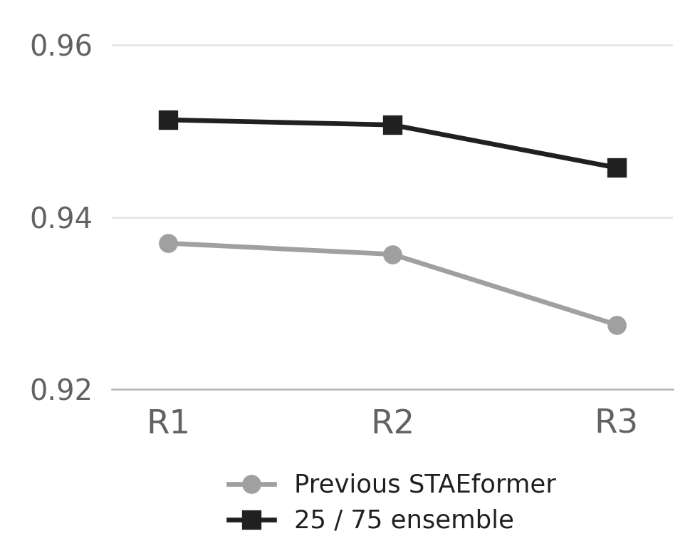
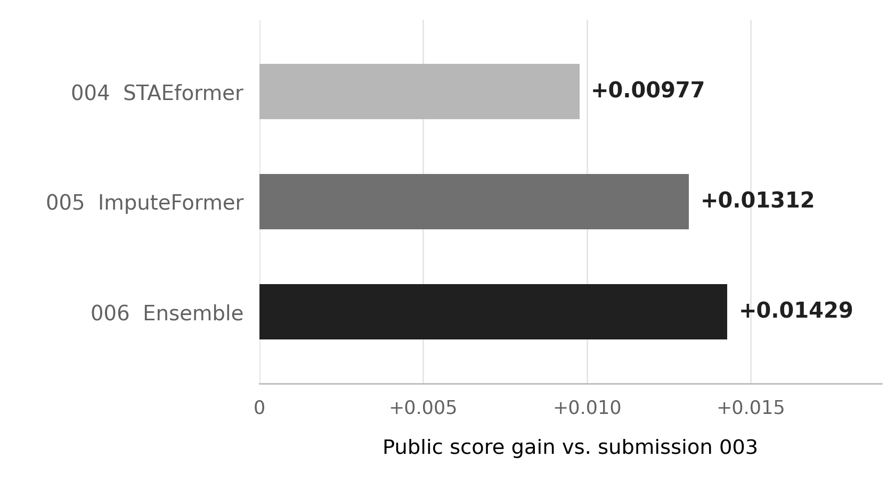

# 2026 IEEE Big Data Traffic Flow Bench 결과보고서

> 작성 기준: 2026-10-21에 완료한 Kaggle 제출 003~006과 저장된 로컬 평가 결과
> 대회: 2026 IEEE Big Data Traffic Flow Bench

## 1. 실험 개요

고속도로 교통 데이터를 이용해 **결측 속도·유량 복원, 정체 예측, 물리 정합성 평가, 경로별 유량 추정**을 하나의 제출 파일로 수행했다. 먼저 네 Task를 모두 처리하는 003 제출을 만들었다. 이후 정체 예측(Task 2)과 경로 유량 추정(Task 4)은 그대로 두고, 결측 상태 복원(Task 1)에 쓰는 모델만 바꿔 004~006을 비교했다.

**최고 결과는 006 앙상블의 Kaggle Public 점수 0.78255**다. 003의 0.76826에서 **0.01429 상승**했다. 004~006은 모두 실제 제출 후 `COMPLETE` 상태로 채점됐다.

## 2. 데이터와 평가 과제

데이터는 10개 방향 corridor의 mainline 링크 **1,583개**를 5분 간격으로 기록한 합성 교통 관측이다. 하루는 288개 시점으로 정렬된다. 학습 구간에는 원본 관측과 masked 관측이 함께 있어 가린 값을 로컬에서 채점할 수 있다. 공식 validation과 private에는 masked 관측만 제공된다.

| Task | 목표 | 이 실험의 방법 | 총점 가중치 |
|---|---|---|---:|
| 1. State | 지정된 위치의 속도·유량 복원 | 보간 + 신경망 residual | 0.35 |
| 2. Queue | 과거 60분으로 향후 5~30분 정체 예측 | CatBoostClassifier | 0.30 |
| 3. Physics | 복원한 속도·유량의 물리 정합성 평가 | Task 1 출력 재사용, 별도 제출 행 없음 | 0.15 |
| 4. ODME | 링크 교통량을 이용한 경로별 유량 추정 | prior 정규화 비음수 최소제곱 | 0.20 |

최종 점수는 `0.35 × S_state + 0.30 × S_queue + 0.15 × S_physics + 0.20 × S_ODME`다. Task 1과 Task 3이 같은 상태 예측값을 사용하므로, **속도·유량을 바꾸면 두 점수가 함께 달라질 수 있다.**

## 3. 전처리와 공통 파이프라인

원본 파일은 날짜·시각·링크 순서로 정렬해 `cache/preprocessed_v1/`에 저장했다. 시간 간격, 링크 매핑, 중복 키, 차로 수, 잘못된 수치와 공식 타깃 누락을 확인했다. 원래 결측과 관측 품질 필드는 유지했다. 학습할 때 유량은 차로 수로 나눈 **차로당 유량**을 사용하고, 제출할 때 다시 `flow_vph`로 변환했다.

Task 1의 복원 흐름은 다음과 같다.

```text
관측 가능한 speed·flow와 관측 여부
        ↓
하루 단위 보간: 보이는 값만 사용
        ↓
시공간 모델: 보간값의 Δspeed·Δflow 예측
        ↓
최종 예측 = 보간값 + residual
        ↓
공식 Task 1 타깃 좌표에만 제출
```

기본 입력 5채널은 **관측 속도, 관측 차로당 유량, 관측 여부, 보간 속도, 보간 차로당 유량**이다. 개선 STAEformer에는 관측 품질과 이전·다음 관측까지의 거리 3채널을 더했다. 보간에는 하루 전체에서 실제로 볼 수 있는 값만 사용했다. Task 1은 오프라인 결측 복원이므로 뒤 시점의 관측도 사용할 수 있다. Task 2의 미래 예측 특징에는 과거 60분만 사용했다.

학습 때는 원본 train에서 `is_score_eligible=1`이고 속도·유량이 모두 있는 셀을 **20%, 30%, 50% 확률로 무작위 가림** 처리했다. 모델 오차는 인위적으로 가린 셀에서만 계산했다. 로컬 평가와 제출 타깃은 `task1/<PANEL>/<split>/sample_submission_state.csv`의 좌표로 지정했다. 따라서 masked 파일의 모든 빈 셀을 채점 대상으로 간주하지 않았다.

## 4. 사용 모델

### Task 1: 보간 + residual 복원

| 제출 | 모델 | 창 길이·입력 | 학습 | 핵심 설정 |
|---|---|---|---|---|
| 003 | 기존 STAEformer residual | 24시점(2시간), 5채널 | 5 epoch | 시공간 attention으로 보간 오차 보정 |
| 004 | 개선 STAEformer residual | 48시점(4시간), 8채널 | 기존 5 epoch에서 15 epoch 추가, 누적 20 | 관측 품질·앞뒤 관측 거리 추가, 창 절반씩 겹쳐 추론 |
| 005 | ImputeFormer residual | 24시점(2시간), 5채널 | 처음부터 20 epoch | 저랭크 시공간 attention, Fourier 정규화 0.01, 창 절반씩 겹쳐 추론 |
| 006 | 004·005 가중 평균 | 두 모델의 예측 결합 | 별도 모델 학습 없음 | STAEformer 25% + ImputeFormer 75% |

두 신경망은 공개된 모델의 핵심 구조를 **이 대회의 결측 복원과 residual 출력에 맞게 바꾼 구현**이다. 논문의 미래 예측 또는 결측 복원 출력층과 실험 결과를 그대로 재현한 모델은 아니다. 두 모델 모두 선택된 residual 혼합 비율은 **1.0**이었다. 즉 보간값에 모델이 예측한 residual 전체를 더했다.

공통 학습 설정은 seed 42, AdamW, 시작 학습률 `3e-4`, BF16, gradient clipping 1.0이었다. 최대 학습은 20 epoch이며, 최소 8 epoch 이후 1월 선택 점수가 4 epoch 연속 `0.00001` 이상 개선되지 않으면 멈추도록 설정했다. 실제 선택 checkpoint는 두 모델 모두 20 epoch였다. 학습은 **물리 GPU 9**에서 진행했다.

### Task 2: CatBoost 정체 예측

003에서 만든 CatBoostClassifier를 004~006에도 동일하게 사용했다. 기준 시각 이전 **12개 5분 시점(60분)**에서 최근 속도·유량·점유율, 추세, 관측 품질, 상·하류 링크 상태와 시간 정보를 추출해, 이후 **6개 5분 시점(5~30분)**의 정체 여부를 예측했다. 공식 정체 라벨은 비공개이므로, train의 관측 속도가 `0.6 × free_speed` 이하인지를 **대체 라벨**로 사용했다. 1월 대체 IoU로 선택한 설정은 **400 trees, 분류 임계값 0.40**이다.

### Task 3: 별도 모델 없음

Task 1에서 제출한 속도·유량을 평가자가 물리 정합성 계산에 다시 사용한다. 별도 예측 파일이나 추가 학습 모델은 없다.

### Task 4: 경로 유량 최적화

경로–링크 연결행렬 `A`, 공개 링크 교통량 `c`, 약한 사전 추정 `b`를 이용했다. 경로 유량 `f`는 음수가 될 수 없도록 제한하고, 다음 식을 풀었다.

```text
minimize ||A f − c||² + 0.05 ||f − b||²
subject to f ≥ 0
```

정규화 계수 `0.05`는 주최측 baseline 설정을 사용했다. 이 Task의 예측값도 003에서 만든 것을 004~006에 그대로 사용했다.

## 5. 실험 설정

| 기간 | 사용 목적 |
|---|---|
| 2030-06 ~ 2030-12 | 로컬 모델 학습 |
| 2031-01 | epoch, residual 비율, 앙상블 비율 선택 |
| 2031-02 | 선택한 설정의 로컬 Task 1 결과 보고 |
| 2030-06 ~ 2031-02 전체 | 공식 제출용 모델 재학습 |
| 2031-03 / 2031-04 | 공식 validation / private 입력에 대한 예측 생성 |

004~006의 비교에서는 **Task 2와 Task 4의 제출값 244,708행을 003과 정확히 같게 고정**했다. 세 제출 CSV는 모두 Kaggle 점수를 확인하기 전에 확정했다. 앙상블의 STAEformer 비율은 1월 결과에서 `0.25`, `0.50`, `0.75`를 비교해 **0.25**를 선택했다. 이 비율은 모든 패널·mask regime에 동일하게 적용했다.

## 6. 결과

### 6.1 로컬 Task 1 결과

로컬 `S_state`는 mask regime별로 `0.54 × max(0, 1 − 속도 RMSE/25) + 0.46 × max(0, 1 − 차로당 유량 RMSE/600)`을 계산한 뒤, 방향·corridor를 동일 가중으로 집계한 값이다. **Kaggle Public 총점과는 다른 지표**다.

| 모델 | 1월 선택 `S_state` | 2월 `S_state` | 기존 대비 2월 상승 |
|---|---:|---:|---:|
| 003 기존 STAEformer | 0.931830 | 0.933377 | — |
| 004 개선 STAEformer | 0.943123 | 0.944272 | +0.010894 |
| 005 ImputeFormer | 0.947440 | 0.948697 | +0.015320 |
| 006 25:75 앙상블 | **0.948117** | **0.949252** | **+0.015875** |

1월 공식 타깃 **3,645,345개**, 2월 공식 타깃 **3,443,944개**를 모두 평가했다. 이 표의 점수는 **6~12월에만 학습한 로컬 모델**의 Task 1 점수다. 최종 제출용으로 9개월 전체를 재학습한 모델의 독립 평가 점수는 아니다.

2월 패널 평균을 mask regime별로 보면 앙상블은 **R1 0.951304, R2 0.950716, R3 0.945737**이었다. 결측이 많은 R3의 점수가 상대적으로 낮았지만, 기존 모델의 R3 **0.927489**보다 높았다.



### 6.2 실제 Kaggle Public 결과

| 제출 | 변경한 Task 1 모델 | Kaggle Public | 003 대비 | Kaggle 제출 ID |
|---|---|---:|---:|---:|
| 003 | 기존 STAEformer | 0.76826 | — | 57461328 |
| 004 | 개선 STAEformer | 0.77803 | +0.00977 | 57468104 |
| 005 | ImputeFormer | 0.78138 | +0.01312 | 57468122 |
| 006 | 25:75 앙상블 | **0.78255** | **+0.01429** | 57468140 |

004~006은 모두 `COMPLETE`로 채점됐다. ImputeFormer가 단일 모델 중 가장 높았고, 006 앙상블은 ImputeFormer 단독보다 **0.00117** 높았다. 각 제출 파일은 공식 템플릿과 같은 **6,980,503행**이며, 누락·중복·비정상 수치와 CSV 저장 전후 일치 검사를 통과했다.



## 7. 해석과 한계

- **검증된 결론:** 003 이후 제출한 세 후보 모두 Public 총점이 올랐고, 실험한 네 구성 중 006이 가장 높았다.
- **점수 해석:** Task 2·4 값은 같으므로 총점 변화는 Task 1의 상태 복원과 그 출력을 사용하는 Task 3의 **합산 효과**다. 공개된 총점만으로 두 Task의 기여도를 따로 계산할 수 없다.
- **로컬 평가 범위:** 2월은 이전 실험에서도 평가했으므로 새롭게 확보한 독립 테스트셋이라고 볼 수 없다. 이번 모델·혼합 비율의 선택은 1월 결과로 했다. 저장된 Kaggle 결과 파일의 private 점수는 `null`이다.
- **원인 분석 범위:** 004는 창 길이, 입력 특징, 학습량, 겹친 창 추론을 함께 바꿨다. 성능 상승을 특정 변경 한 가지의 효과로 단정할 수 없다. 독립 무작위 학습 mask와 공식 R1/R2/R3의 결측 패턴 사이에도 차이가 있다.

다음 실험에서는 시간 구간과 인접 링크를 함께 가리는 학습 mask를 적용하고, 창 길이·추가 특징·학습량은 각각 따로 바꿔 효과를 확인하는 것이 좋다. **이 추가 실험은 아직 실행하지 않았다.**

## 8. 결과와 코드 위치

| 파일 | 내용 |
|---|---|
| [004~006 비교 데이터](runs/ensemble_006/comparison_with_kaggle.json) | 로컬 점수와 실제 Kaggle Public 점수 |
| [제출 완료 검증](runs/ensemble_006/completion_audit.json) | 3건 상태·CSV·Task 2/4 고정 여부 |
| [003 기본 실험](docs/multitask-003.md) | 네 Task의 모델·전처리·평가 설정 |
| [004~006 상세 실험](docs/task1-upgrade-004-006.md) | 모델 변경점·기간 분할·재현 방법 |
| [실험 설정](configs/task1_upgrade_004_006.json) | seed·입력·학습·앙상블 설정 |
| [Task 1 학습·추론 코드](src/task1/upgrade.py), [ImputeFormer 모델](src/task1/imputeformer_model.py) | 상태 복원 모델 구현 |
| [004 결과](submissions/004_staeformer/result.json), [005 결과](submissions/005_imputeformer/result.json), [006 결과](submissions/006_ensemble/result.json) | Kaggle 채점 기록 |
| [영문 발표 PPT](presentation/TrafficFlowBench_Model_Comparison_EN.pptx) | 이번 결과의 6장 발표 자료 |

위 결과는 저장된 실험 파일과 제출 영수증을 기준으로 정리했다. 데이터와 모델 가중치는 저장소의 `data/`, `cache/`, `runs/`에 있으며, 큰 원본·체크포인트·제출 CSV는 Git에서 제외한다.
